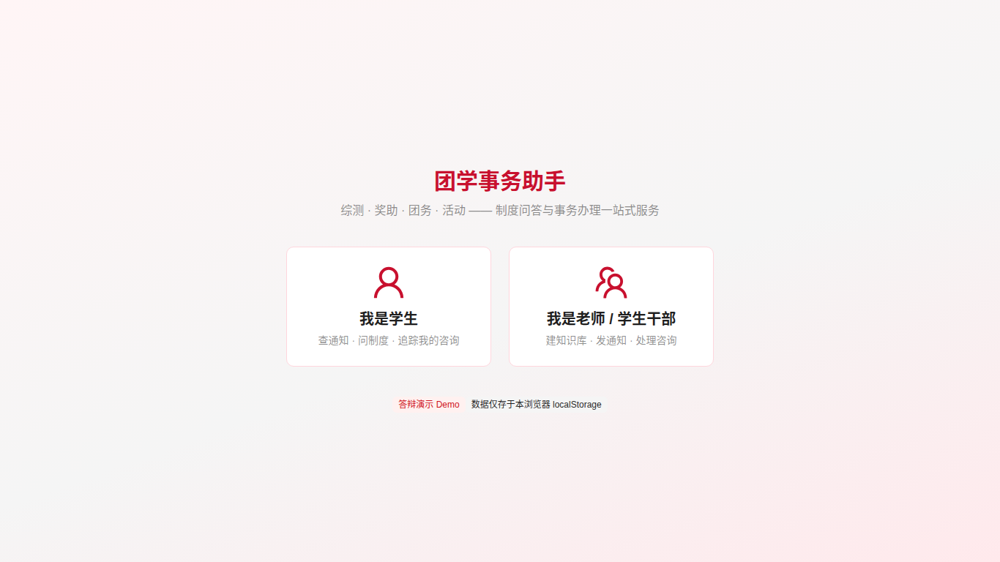
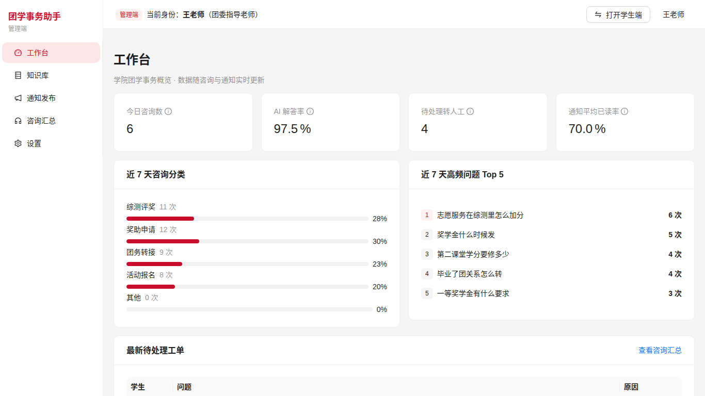
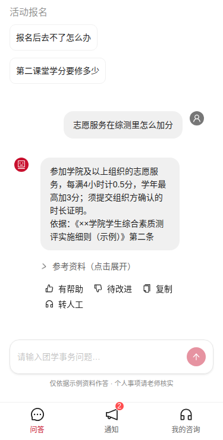
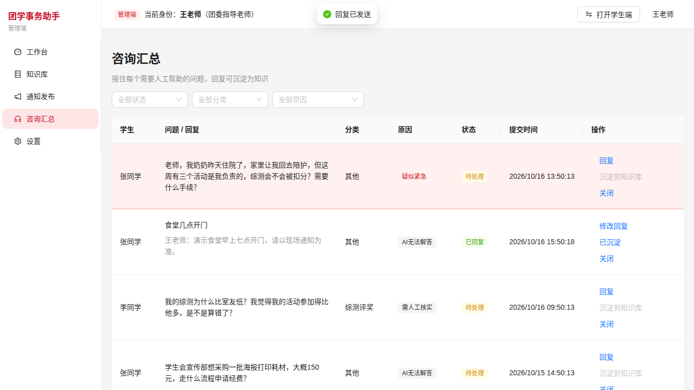
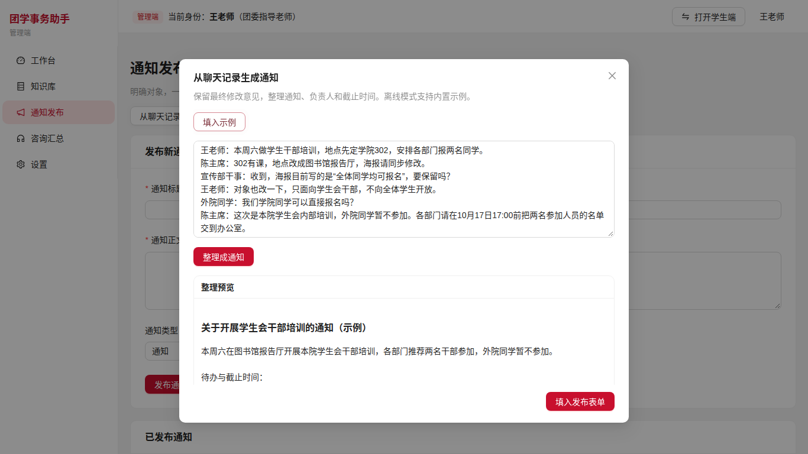

# 学院团学事务助手

面向学院学生、老师和学生干部的网页 Demo：依据制度解答问题，资料外问题转人工，老师回复沉淀成知识，通知按对象发布并同步已读。

[在线离线演示](https://alpszz-cc.github.io/tuanxue-assistant/) · [5 分钟演示脚本](docs/DEMO_SCRIPT.md) · [开发进度与验收](docs/PROGRESS.md)

## 演示入口

本地运行后，在同一浏览器打开两个窗口：

- [学生端 · 张同学](http://localhost:4173/#/student/chat?as=stu001)
- [管理端 · 王老师](http://localhost:4173/#/admin/dashboard?as=admin_wang)

学生版式最大宽度480px；管理端适合桌面，窄屏自动收起侧栏。所有身份是 mock，制度和联系方式均为虚构示例，不是实际学校政策。身份保存在各标签页 sessionStorage，业务数据在 localStorage，同源窗口自动同步；数据不会上传至后端数据库。

## 本地运行

需要 Node.js 22.12+：

```sh
npm ci
npm run demo
```

打开 http://localhost:4173/ 。演示前到管理端设置重置数据，保持离线模式。开发使用 `npm run dev`；验证使用 `npm test`、`npm run build`。

## 已实现

- 学生端：四类八个推荐问题、制度检索与来源原文、流式问答、反馈/复制、自动或手动转人工、通知和我的咨询。
- 管理端：实时统计、制度新增/上传（txt/md/docx）、通知对象与已读回执、工单回复与知识沉淀、模式切换和连接测试。
- 沟通整理：从群聊生成通知、待办、截止时间及最终修改意见，核对后发布给学生会干部；内置示例支持完整离线演示。
- 数据：5份示例资料、5条通知、6条工单、40条近7天历史咨询，支持一键重置。

## 页面预览







## 接入 Hermes 或兼容接口

复制 `.env.example` 为 `.env.local`，配置服务器端 BASE、Key 和模型 id，重新启动开发或 demo 服务。BASE 加 `/v1/chat/completions` 必须是有效端点；不要重复加 `/v1`。Key 只由 Vite 开发/预览代理注入，不进入前端包。问答模式在设置页切换。

真实 Hermes 的技能与安装说明见 [hermes/README.md](hermes/README.md)。本机入口暂未修复，setup 只能在真实 SSH 终端审核后运行。兼容层已用本地模拟服务验证，尚未声称完成真实 Hermes 联调。

开发验证可运行 `npm run mock-llm`，把 BASE 临时设为 `http://127.0.0.1:8659`；此服务只提供固定测试回答，不用于正式演示。请求失败、超时或空回答会自动降级至离线。静态 Pages 没有 Vite 代理，默认使用离线模式。

## GitHub Pages

`.github/workflows/pages.yml` 在 main 推送后执行 `npm ci && npm run build`、测试并部署 dist。仓库 Pages Source 应为 GitHub Actions（本仓库已设置）。HashRouter 与相对 base 支持子目录部署。静态站点无密钥、无服务端代理。

## 技术与后续路线

Vite + React + TypeScript，antd 6 + Ant Design X 2，HashRouter，zustand persist，mammoth。无业务后端、数据库、向量库或额外 UI 框架。

后续可在真实环境联调 Hermes，通过其 QQ / 微信网关接入群聊，对接学校统一身份认证，升级向量检索，并推广到其他学院。当前 Demo 不包含这些集成。
